 

---

### 👋 About me

I'm a developer from Madagascar 🇲🇬 who loves turning ideas into code, from web apps to games.

- 💻 I enjoy building clean, useful software with **Rust**, **TypeScript**, **Python** and more
- 🎮 Passionate about **game design**: creating mechanics, systems and worlds that are fun to play
- 🌱 Always learning something new
- 🌐 Portfolio: https://nomeny.is-a.dev

### 🛠️ Tech Stack

**Programming Languages**

**Game Engines**

### 📊 GitHub Stats

### 🐍 Contribution Snake

<picture>
  <source media="(prefers-color-scheme: dark)" srcset="https://raw.githubusercontent.com/Ydiboras04/Ydiboras04/output/github-snake-dark.svg"/>
  <source media="(prefers-color-scheme: light)" srcset="https://raw.githubusercontent.com/Ydiboras04/Ydiboras04/output/github-snake.svg"/>
  
</picture>

